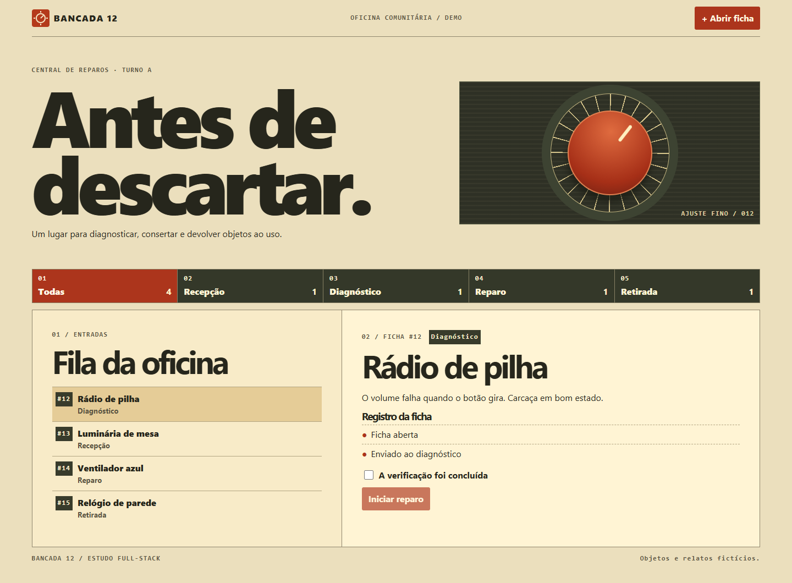

# Bancada 12

Painel de triagem para uma oficina comunitária fictícia. Abra fichas, filtre a fila e acompanhe cada objeto da recepção à retirada.



O fluxo de cartões do [Trello](https://trello.com/guide/trello-101) inspirou a passagem entre etapas. Aqui o trabalho é apresentado como uma fila de entrada e uma ficha com relato e histórico, em uma identidade de oficina.

Svelte no navegador, Valibot na validação e SQLite/D1 na persistência. O servidor exige confirmação de verificação para sair do diagnóstico e recusa gravações baseadas em uma fila antiga. Os dados iniciais são fictícios. As mudanças ficam isoladas por bancada durante sete dias após a última gravação.

## Desenvolvimento

Node.js 24 e npm.

```sh
npm ci
npm run build
npm start
```

Abra http://127.0.0.1:4173. O SQLite local fica em `.local/bancada.sqlite`.

```sh
npm test
npx playwright install chromium
npm run test:browser
```

[Contrato de integração](docs/solution-contract.md)
